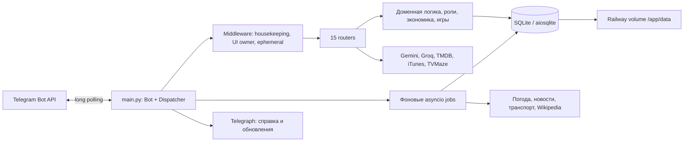

# Архитектура Норы

Источник: commit 00d9e08621c527d827ffc258424eb047d0c3e19e, 2026-10-25.
56 Python-файлов приложения, около 23 тысяч строк. Один сервис.

## Запуск и пользовательские интерфейсы

Точки входа: community_bot.main:run, python -m community_bot.main, nore-bot.
Startup читает Settings, инициализирует SQLite, назначает owner-роли,
подключает middleware/routers, настраивает команды, публикует справку/обновления,
удаляет webhook без сброса pending updates и запускает polling.

| Модули | Назначение |
|---|---|
| routers/private.py, flows.py, profile.py | Меню, анкеты, тикеты, кабинет, профиль, администрирование |
| routers/group.py, notices.py | Сообщество, модерация, репутация, уведомления |
| routers/wallet.py, shop_admin.py | Балансы, переводы, кредиты, каталог |
| routers/pets.py, life.py | Питомцы, экспедиции и жизненные механики |
| routers/games.py, cookie_games.py, social_games.py, contest.py | Игры и конкурсы |
| routers/command_admin.py, nora.py | Студия команд и помощник |
| helpers.py, permissions.py, ui_owner.py | Роли, разрешения, ранги и защита личных inline-меню |
| blocks.py, covers.py, keyboards.py, texts.py | Telegram-карточки, изображения, кнопки, тексты |

Самостоятельных HTTP-server, FastAPI/Flask или фронтенда в этом дереве нет.
Кабинет — сообщения и inline-кнопки Telegram.

## Данные и платежи

database.py содержит SCHEMA, CRUD и транзакции. 41 таблица: пользователи,
анкеты, тикеты/сообщения, репутация, переводы/транзакции/кредиты, bot_state,
настройки/входящие уведомления, заказы печенек, расписания, рулетка, бонусы,
feature flags, аудит/активность, питомцы/роли, игры/участники/голоса, жалобы,
почта, стоп-слова, события/достижения/рейтинги, overrides команд, лотереи,
конкурсы, captcha, сообщения чата, категории/товары, владельцы UI и предложения.

SCHEMA включает WAL; foreign_keys включаются при каждом connect.
initialize() выполняет PRAGMA/ALTER TABLE и seed ролей/каталога/флагов,
синхронизирует часть прикладных данных. Отдельного versioned migration framework нет.
Реальная production база не открывалась.

СБП работает вручную: пользователь присылает чек, сотрудник подтверждает заявку.
review_cookie_order использует BEGIN IMMEDIATE и pending-проверку; защита от
повторного начисления покрыта тестом. Банковского webhook здесь не обнаружено.
bot_state хранит telegraph_token и идентификаторы страниц: копии DB секретны.

## Фоновые задания и интеграции

main создаёт jobs восстановления репутации, автосообщений, питомцев,
digest уведомлений, кредитов, weekly board, morning digest, daily chat,
day note, аварийной остановки и перезапуска. Dispatcher использует FSM storage
по умолчанию в памяти: незавершённые диалоги могут теряться при рестарте.

- Telegram: основной интерфейс, модерация и media file_id.
- Telegraph: справка/обновления, токен создаётся приложением и хранится в SQLite.
- Open-Meteo, Yandex traffic, Fontanka, metro.spb.ru: утренняя сводка.
- Wikipedia: события дня и справка; iTunes/TVMaze/TMDB: музыка/кино.
- Gemini/Groq: необязательные ключи помощника.
- СБП: внешняя ссылка, подтверждение сотрудником по чеку.

Обязательны BOT_TOKEN и OWNER_ID. OWNER_IDS объединяется с OWNER_ID.
COMMUNITY_CHAT_ID имеет приоритет перед GROUP_ID. DATABASE_PATH по умолчанию
data/community.db. Конкретные production значения не извлекались.

## Deployment

GitHub fedorabakumets/nore-community-bot → cursor/nora-2-update-d133 →
Railway nora-community-bot / production / nora-bot. Автодеплой без ожидания CI.
GitHub Actions и lock-файла зависимостей в дереве нет.
Dockerfile: Python 3.12-slim, pip install ., root entrypoint для прав на /app/data,
затем runuser botuser. Если runuser недоступен, допускается запуск без смены UID.
Compose относится к самостоятельному запуску, не управляет текущим Railway.
